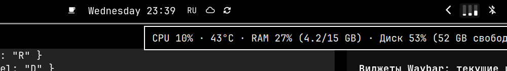

# Sysmon

Three compact gauges for the [Omarchy](https://omarchy.org/) bar: **CPU load**, **RAM usage**, and **disk usage**. Hover for the numbers, click to open btop.




The gauges read left to right as **CPU**, **RAM**, **disk**. Each one has a dim track behind the fill and sits on a faint rounded card, so it reads as a mini chart instead of a wireless-signal icon. A gauge turns the theme's accent color when its metric reaches 85%.

## Features

- **CPU load** from a `/proc/stat` delta between polls (real current load, not the boot average) and **CPU temperature** from the `coretemp` hwmon sensor.
- **RAM usage** from `/proc/meminfo` (used vs. total, with `MemAvailable`).
- **Disk usage** of `/` from `statvfs`.
- **Hover tooltip**: `CPU 10% · 43°C · RAM 27% (4.2/15 GB) · Disk 53% (52 GB free) · Click for btop`.
- **Click** opens btop by default; the command is configurable.
- **Cheap**: no root, no `sensors`, no `nvidia-smi`, no extra packages. A poll costs roughly 7 ms once every 10 seconds and touches only `/proc`, `/sys`, and one `stat` call.

## Requirements

- Omarchy 4.x (the Quickshell-based shell, with `~/.config/omarchy/shell.json`)
- Optional: `btop` for the default click action

## Install

```bash
omarchy plugin add https://github.com/sl0vvman/omarchy-sysmon.git --enable
omarchy bar move sl0vvman.sysmon --section right
```

`--enable` adds the widget to its default section (`right`). Place it wherever you like with `omarchy bar move`.

Or install manually:

```bash
git clone https://github.com/sl0vvman/omarchy-sysmon.git \
  ~/.config/omarchy/plugins/sl0vvman.sysmon
omarchy plugin enable sl0vvman.sysmon --section right
```

## Settings

Set them from the bar's settings panel, or from the command line:

| Key | Default | Meaning |
| --- | --- | --- |
| `refreshIntervalSec` | `10` | Seconds between polls (2–3600) |
| `clickCommand` | `omarchy-launch-or-focus-tui btop` | Command run on click |

```bash
omarchy bar set sl0vvman.sysmon refreshIntervalSec 30
omarchy bar set sl0vvman.sysmon clickCommand "omarchy-launch-or-focus-tui htop"
```

## How it works

`Panel.qml` draws the three gauges and polls the `sysmon` helper script, which prints one JSON line:

```json
{"cpu":10,"ram":27,"disk":53,"temp":43,"tooltip":"CPU 10% · 43°C · ..."}
```

The script keeps the previous CPU counters in `$XDG_RUNTIME_DIR/omarchy-sysmon.cpu` so it can report load over the last interval. If the script is missing or fails, the widget keeps the last known values.

To localize the tooltip text, edit the `tooltip=` line in `sysmon`.

## Uninstall

```bash
omarchy plugin remove sl0vvman.sysmon
```

## License

MIT
